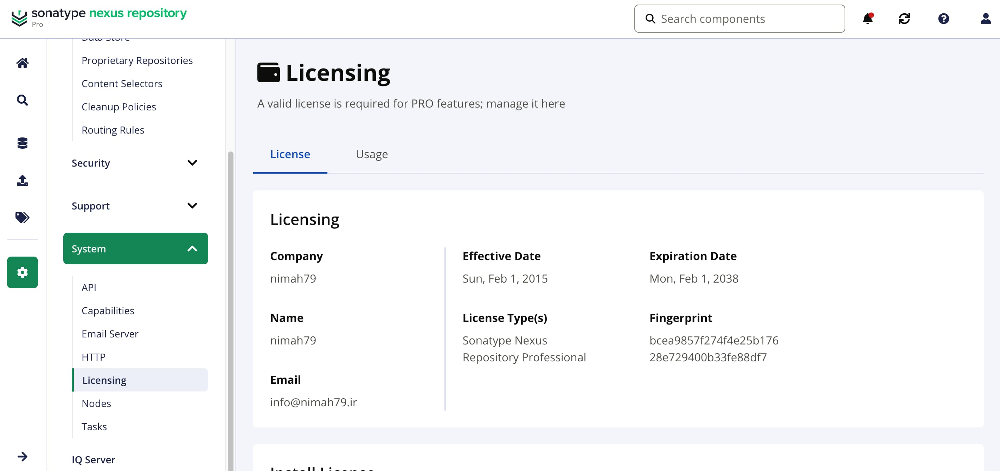

# [Sonatype Nexus Repository](https://www.sonatype.com/products/sonatype-nexus-repository) License Bypass Agent

A javaagent that patches [Sonatype Nexus Repository](https://www.sonatype.com/products/sonatype-nexus-repository) license managers to bypass license verification

Latest tested version: [3.98.3](https://help.sonatype.com/en/sonatype-nexus-repository-3-90-0-release-notes.html)

**⚠️ YOU SHOULD NEVER USE THIS PROJECT TO CRACK/PATCH/ ILLEGAL USE SONATYPE NEXUS REPOSITORY. THIS PROJECT IS FOR EDUCATIONAL PURPOSES! THE CONSEQUENCES CAUSED BY THE USE OF THIS SOFTWARE SHALL BE BORNE BY THE USER.**

## Build

The prebuilt jar file of the javaagent is available in `nexus-repository-license-bypass-agent-1.0.jar`. However, if you have modified the source code, you can build the jar file using the following command:

```bash
mvn clean package
```

## Run Nexus with Patched License

### Method 1: Using Docker Compose and the original Nexus Docker image

```bash
docker compose up
```

### Method 2: Building a custom Docker image

```bash
docker build -t nexus:latest .
```

## Customizing the Fake License

The contact info and dates of the fake license are fully configurable via
environment variables (preferred) or JVM system properties. Any variable that
is not set falls back to the default value shown below.

| Environment Variable | Default | Description |
|---|---|---|
| `NEXUS_LICENSE_CONTACT_NAME` | `nimah79` | Contact name |
| `NEXUS_LICENSE_CONTACT_COMPANY` | `nimah79` | Contact company |
| `NEXUS_LICENSE_CONTACT_EMAIL` | `info@nimah79.ir` | Contact email address |
| `NEXUS_LICENSE_CONTACT_TELEPHONE` | `11011001110` | Contact telephone |
| `NEXUS_LICENSE_CONTACT_COUNTRY` | `Iran` | Contact country |
| `NEXUS_LICENSE_EFFECTIVE_DATE` | `2015-01-01` | License effective date (`yyyy-MM-dd`) |
| `NEXUS_LICENSE_EXPIRATION_DATE` | `2038-01-01` | License expiration date (`yyyy-MM-dd`) |

### Via environment variables

Docker Compose (add to the `nexus` service in `docker-compose.yaml`):

```yaml
services:
  nexus:
    environment:
      NEXUS_LICENSE_CONTACT_NAME: "Jane Doe"
      NEXUS_LICENSE_CONTACT_COMPANY: "ACME Corp"
      NEXUS_LICENSE_CONTACT_EMAIL: "jane@acme.com"
      NEXUS_LICENSE_CONTACT_TELEPHONE: "+1 555 0100"
      NEXUS_LICENSE_CONTACT_COUNTRY: "USA"
      NEXUS_LICENSE_EFFECTIVE_DATE: "2020-01-01"
      NEXUS_LICENSE_EXPIRATION_DATE: "2099-12-31"
```

Plain shell (e.g. when running `java -jar nexus...` directly):

```bash
export NEXUS_LICENSE_CONTACT_NAME="Jane Doe"
export NEXUS_LICENSE_EXPIRATION_DATE="2099-12-31"
```

### Via JVM flags

The same variables can also be passed as JVM system properties, e.g. in the
`JAVA_OPTIONS`/`INSTALL4J_ADD_VM_PARAMS` used to start Nexus:

```bash
java -DNEXUS_LICENSE_CONTACT_NAME="Jane Doe" \
     -DNEXUS_LICENSE_EXPIRATION_DATE="2099-12-31" \
     -javaagent:nexus-repository-license-bypass-agent-1.0.jar -jar nexus...
```

Environment variables take precedence over JVM flags. Invalid dates are
ignored with a warning and the default date is used instead. The resolved
values are printed to the Nexus log at startup
(`[NexusLicenseAgent] License contact info: ...`).

## What the Agent Does

The agent intercepts and patches these classes:
- `org.sonatype.licensing.internal.DefaultLicenseManager`
- `org.sonatype.licensing.trial.internal.DefaultTrialLicenseManager`
- `org.sonatype.licensing.internal.DefaultFeatureValidator`
- `org.sonatype.licensing.product.internal.DefaultLicenseFeatureVerifier`

The Java source code of these classes are extracted from the jar file in the original Nexus Docker image using [jadx-gui](https://github.com/skylot/jadx).

Note: It seems that only the `org.sonatype.licensing.trial.internal.DefaultTrialLicenseManager` class is being used by Nexus and the `org.sonatype.licensing.internal.DefaultLicenseManager` class is unused.

Methods like `verifyLicense` and `installLicense` are patched to return a fake professional license:

- **Contact Name**: nimah79
- **Contact Company**: nimah79
- **Contact Email**: info@nimah79.ir
- **Contact Telephone**: 11011001110
- **Contact Country**: Iran
- **Evaluation**: false
- **Expiration Date**: 2038-01-01
- **Effective Date**: 2015-01-01
- **Features**: every licensed feature that exists in the running Nexus version
  (NexusProfessionalFeature, SamlFeature, OAuth2Feature, GroupWriteFeature,
  ExportImportFeature, etc.), including the NexusEnterpriseFeature, so Nexus
  starts with the Enterprise edition and Enterprise-only features such as
  Global Distribution work

Every feature-gated capability in Nexus is checked through
`LicenseFeatureVerifier`, which matches the feature id (e.g. `saml`, `oauth2`,
`groupWrite`, `exportImport`) against the license `FeatureSet` and rejects with
e.g. `License does not permit use of feature 'groupWrite'` or
`Repository export is not licensed!` when the id is absent. The fake license
therefore registers all known feature classes (looked up reflectively in the
Nexus class loader, so versions without a feature simply skip it), and in
addition `DefaultFeatureValidator` is patched to accept every feature, so
functionality keeps working even for features that are not in the list.



## How It Works

```
JVM Start
    │
    ▼
Load nexus-repository-license-bypass-agent-1.0.jar
    │
    ▼
Call NexusLicenseAgent.premain()
    │
    ▼
Register ClassFileTransformer
    │
    ▼
Load License Manager classes
    │
    ▼
Javassist patches methods like installLicense and verifyLicense
    │
    ▼
Nexus runs with patched license check
```
