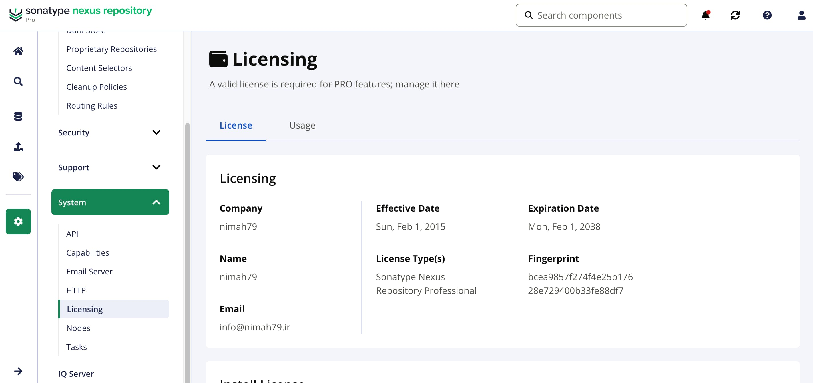

# [Sonatype Nexus Repository](https://www.sonatype.com/products/sonatype-nexus-repository) License Bypass Agent

A javaagent that patches [Sonatype Nexus Repository](https://www.sonatype.com/products/sonatype-nexus-repository) license managers to bypass license verification

Latest tested version: [3.93.0](https://help.sonatype.com/en/sonatype-nexus-repository-3-93-0-release-notes.html) (also verified on 3.90.1)

**⚠️ YOU SHOULD NEVER USE THIS PROJECT TO CRACK/PATCH/ ILLEGAL USE SONATYPE NEXUS REPOSITORY. THIS PROJECT IS FOR EDUCATIONAL PURPOSES! THE CONSEQUENCES CAUSED BY THE USE OF THIS SOFTWARE SHALL BE BORNE BY THE USER.**

## Build

The prebuilt jar file of the javaagent is available in `nexus-repository-license-bypass-agent-1.0.jar`. However, if you have modified the source code, you can build the jar file using the following command:

```bash
mvn clean package
```

## Run Nexus with Patched License

### Method 1: Using Docker Compose and the original Nexus Docker image

```bash
docker compose up
```

### Method 2: Building a custom Docker image

```bash
docker build -t nexus:latest .
```

## What the Agent Does

The agent intercepts and patches these classes:
- `org.sonatype.licensing.internal.DefaultLicenseManager`
- `org.sonatype.licensing.trial.internal.DefaultTrialLicenseManager`

The Java source code of these classes are extracted from the jar file in the original Nexus Docker image using [jadx-gui](https://github.com/skylot/jadx).

Note: It seems that only the `org.sonatype.licensing.trial.internal.DefaultTrialLicenseManager` class is being used by Nexus and the `org.sonatype.licensing.internal.DefaultLicenseManager` class is unused.

Methods like `verifyLicense` and `installLicense` are patched to return a fake professional license:

- **Contact Name**: nimah79
- **Contact Company**: nimah79
- **Contact Email**: info@nimah79.ir
- **Contact Telephone**: 11011001110
- **Contact Country**: Iran
- **Evaluation**: false
- **Expiration Date**: 2038-01-01
- **Effective Date**: 2015-01-01
- **Features**: NexusProfessionalFeature, SamlFeature, OAuth2Feature

The SAML and OAuth2 features are required for the SAML SSO Realm and the OIDC
(OAuth2) realm: without them Nexus authenticates the user against the IdP but
rejects the login with `SamlRealm - Unable to login ... due to license limitation`
(`LicenseFeatureVerifier` checks the license `FeatureSet` for feature id `saml` /
`oauth2`).



## How It Works

```
JVM Start
    │
    ▼
Load nexus-repository-license-bypass-agent-1.0.jar
    │
    ▼
Call NexusLicenseAgent.premain()
    │
    ▼
Register ClassFileTransformer
    │
    ▼
Load License Manager classes
    │
    ▼
Javassist patches methods like installLicense and verifyLicense
    │
    ▼
Nexus runs with patched license check
```
